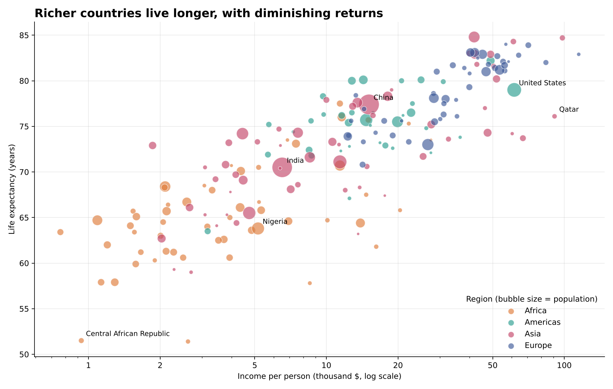
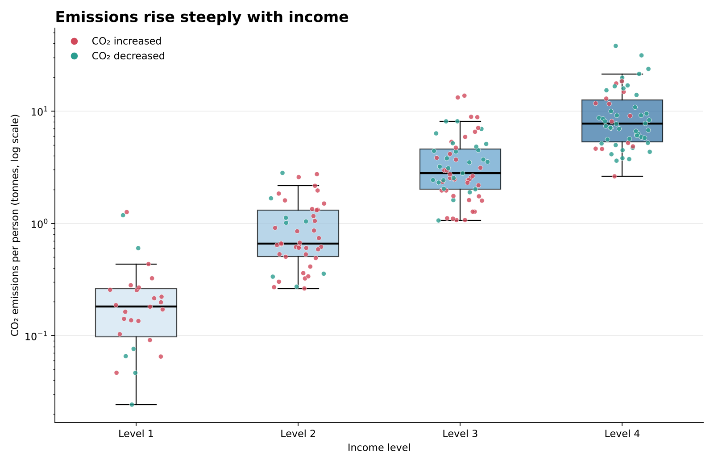
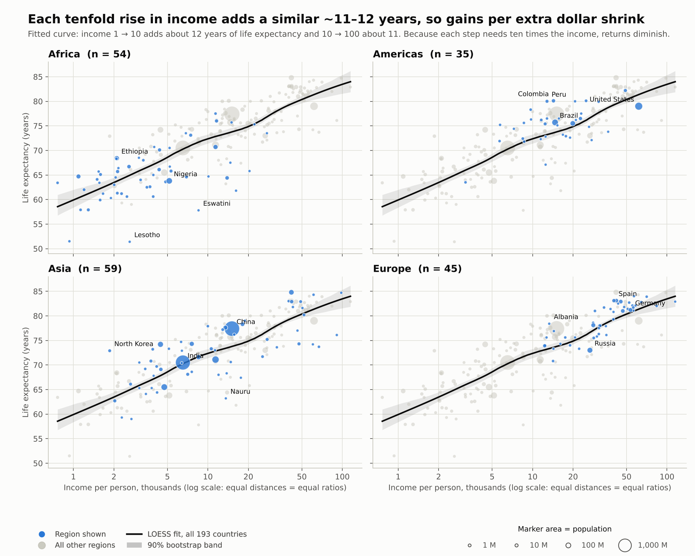
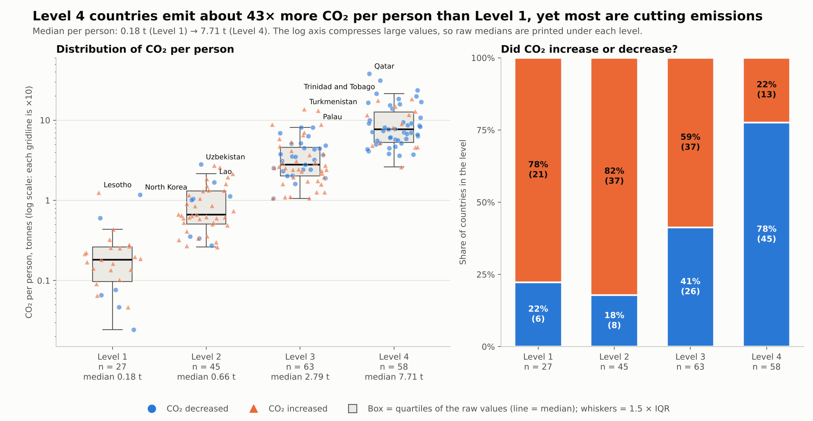

# 4DT909 | Assignemnt 2

Date: 2026-10-16

Name: Samuel Fredric Berg

Student ID: sb224sc

## Question 1

LLM: Claude Sonnet 5.5

Prompt:

```Markdown
Based on this dataset create two recommended/optimal visualizations
```

Response:

```Markdown
1. Income vs. life expectancy (viz1_income_vs_life_expectancy.png)
    - This is a bubble scatter plot. Income is on the x-axis (log scale), life expectancy on the y-axis, colour shows region and bubble size shows population.
    - I chose it because both variables are continuous, and the log scale spreads out the many low- and middle-income countries. It lets one chart show four variables at once.
    - It shows that life expectancy rises quickly with income and then levels off. Africa clusters at the low end and Europe at the high end. China and India stand out as the largest bubbles.
```



```Markdown
2. CO₂ emissions by income level (viz2_co2_by_income_level.png)

    - This is a box plot with every country overlaid as a dot. The dots are coloured by whether the country’s CO₂ increased or decreased.
    - I chose it because it compares a numeric variable across the four income levels. It also brings in the co2_change category, which the first chart doesn’t use.
    - Median emissions climb steeply across the levels: about 0.18 tonnes per person at Level 1, 0.66 at Level 2, 2.79 at Level 3 and 7.71 at Level 4.
    - Emissions are still growing in most low-income countries (21 of 27 at Level 1) but are falling in most high-income ones (45 of 58 at Level 4).
    - Qatar and Trinidad and Tobago are very high outliers; I left the box plot’s outlier markers off, but they still show as dots.
```



## Question 2

### Visualization 1

Supports the following tasks:

- Assessing whether richer countries tend to live longer
- Looking for diminishing returns
- Identifying regional clustering, outliers, and populous countries
- Comparing countries on two quantitative dimensions plus a categorical grouping

Opportunities for improvement:

- **Visual encoding**: Bubble area encodes less accurate than position or length. Lacks interpretation except for relational. Utilize a bubble size legend, reduce maximum bubble size or use transparency/strokes to reduce occlusion
- **Overplotting**: The plot is crowded, many small bubbles overlap, and only a few countries are labeled. Interactive hover/tooltips, zooming or linked highlighting would help
- **Log income axis**: A log scale is appropriate but many readers misread log axes. A fitted curve or LOESS line would better support the "diminishing returns" as it then is demonstrated not asserted
- **Color and region**: Color hue encodes region are fine, but the palette lacks colorblind safety. Adding shape or direct labels could help
- **Data abstraction**: It is not clear whether "income" is GDP per capita or another measure, meanwhile the population encoding also lacks units or scale
- **Interaction**: As a static chart, it does not support lookup tasks. Adding tooltips, region filters or linked brushing with the $CO_2$ chart would make it more analytically useful
- **Task support**: It is good for overview and pattern detection, but weak for precise ranking or identifying specific countries especially small ones

### Visualization 2

Supports the following tasks:

- Assessing whether $CO_2$ emissions rise with income level
- Comparing medians, interquartile ranges, spread and outliers across income groups
- Seeing whether $CO_2$ increases or decreases are spread across income levels via the colored jitter points
- Summarizing a skewed quantitative variable using a log scale

Opportunities for improvement:

- **Visual encoding**: Boxplots summarize distributions well, and the log y-axis is appropriate. If the boxplots are computed on the log-transformed scale it can make the IQR look more symmetric than it is on the raw scale. This should be made explicit
- **Red/green encoding**: The $CO_2$ change variable uses red for "increased" and green for "decreased". This is semantically intuitive for many but problematic for red-green colorblind users. Use a colorblind safe palette or encode change with shape for instance
- **Overplotting**: The jittered points add useful individual level detail at the cost of clutter. Jitter width and point size could be tuned or points could be made semitransparent
- **Aggregation hides country identity**: The boxplots aggregate all countries within an income level. If the analytical goal includes identifying which countries drive high emissions or which countries increased/decreased, labels or interactive tooltips are needed
- **No sample size indicator**: Income levels contain different numbers of countries. Adding n per group or width proportional to n, would help readers judge reliability
- **Title vs. scale**: "Emissions rise steeply with income" is somewhat misleading on a log y-axis, because log scales compress large values. The increase is real, but "steeply" depends on scale. A raw-scale inset or a note about the log transformation would clarify this
- **Interaction**: Static chart limits exploration. Linked selection with the scatterplot, filtering by region or hovering for country details would improve task support
- **Task support**: It is strong for distributional comparison across income levels, but weaker for country level explanation or precise change analysis. Splitting or faceting by $CO_2$ change or adding proportion labels, would better support the "increase vs. decrease" question

## Question 3

LLM: Claude Sonnet 5.5

Prompt:

```Markdown
Based on the following feedback present me with a couple of alternative improved visualizations

### Visualization 1

Supports the following tasks:

    Assessing whether richer countries tend to live longer
    Looking for diminishing returns
    Identifying regional clustering, outliers, and populous countries
    Comparing countries on two quantitative dimensions plus a categorical grouping

Opportunities for improvement:

    **Visual encoding**: Bubble area encodes less accurate than position or length. Lacks interpretation except for relational. Utilize a bubble size legend, reduce maximum bubble size or use transparency/strokes to reduce occlusion
    **Overplotting**: The plot is crowded, many small bubbles overlap, and only a few countries are labeled. Interactive hover/tooltips, zooming or linked highlighting would help
    **Log income axis**: A log scale is appropriate but many readers misread log axes. A fitted curve or LOESS line would better support the "diminishing returns" as it then is demonstrated not asserted
    **Color and region**: Color hue encodes region are fine, but the palette lacks colorblind safety. Adding shape or direct labels could help
    **Data abstraction**: It is not clear whether "income" is GDP per capita or another measure, meanwhile the population encoding also lacks units or scale
    **Interaction**: As a static chart, it does not support lookup tasks. Adding tooltips, region filters or linked brushing with the $CO_2$ chart would make it more analytically useful
    **Task support**: It is good for overview and pattern detection, but weak for precise ranking or identifying specific countries especially small ones

### Visualization 2

Supports the following tasks:

    Assessing whether $CO_2$ emissions rise with income level
    Comparing medians, interquartile ranges, spread and outliers across income groups
    Seeing whether $CO_2$ increases or decreases are spread across income levels via the colored jitter points
    Summarizing a skewed quantitative variable using a log scale

Opportunities for improvement:

    **Visual encoding**: Boxplots summarize distributions well, and the log y-axis is appropriate. If the boxplots are computed on the log-transformed scale it can make the IQR look more symmetric than it is on the raw scale. This should be made explicit
    **Red/green encoding**: The $CO_2$ change variable uses red for "increased" and green for "decreased". This is semantically intuitive for many but problematic for red-green colorblind users. Use a colorblind safe palette or encode change with shape for instance
    **Overplotting**: The jittered points add useful individual level detail at the cost of clutter. Jitter width and point size could be tuned or points could be made semitransparent
    **Aggregation hides country identity**: The boxplots aggregate all countries within an income level. If the analytical goal includes identifying which countries drive high emissions or which countries increased/decreased, labels or interactive tooltips are needed
    **No sample size indicator**: Income levels contain different numbers of countries. Adding n per group or width proportional to n, would help readers judge reliability
    **Title vs. scale**: "Emissions rise steeply with income" is somewhat misleading on a log y-axis, because log scales compress large values. The increase is real, but "steeply" depends on scale. A raw-scale inset or a note about the log transformation would clarify this
    **Interaction**: Static chart limits exploration. Linked selection with the scatterplot, filtering by region or hovering for country details would improve task support
    **Task support**: It is strong for distributional comparison across income levels, but weaker for country level explanation or precise change analysis. Splitting or faceting by $CO_2$ change or adding proportion labels, would better support the "increase vs. decrease" question
```

Respone:

```Markdown
Set A: static charts

Income and life expectancy (v2_A1_income_life_by_region.png)

CO₂ by income level (v2_A2_co2_by_income_level.png)

Set B: interactive page

Hover any mark to see the country’s income, life expectancy, CO₂, change and population. The same country highlights in both charts.
Drag a box on the scatter to select countries; the CO₂ chart, the summary figures and the table update with the selection.
Region and income-level filters, a switch for sizing by population, a Reset button, and a sortable table view.
Region is shown by marker shape and CO₂ change by colour, so neither relies on colour alone.

The file has no data dictionary, so I assumed the units from the value ranges: income in thousands per person, CO₂ in tonnes per person, population in millions. Please confirm these before submitting. I also assumed income levels 1 to 4 run from lowest to highest, which the data supports.
```




### Changes

Income Life by Region:

```Markdown
Overplotting: one panel per region, with the region in blue and all other countries in grey behind it.
Diminishing returns: a LOESS curve with a 90% bootstrap band is drawn on every panel, and the log axis is explained on the chart.
Encoding: a population size legend, smaller bubbles and white outlines.
Labels: the largest and most unusual countries in each region are labelled and kept from overlapping.
Colour: the four-region colour problem disappears because the panels carry the region. The default palette has no four-colour set that stays distinguishable for everyone, which is why I moved region into panels and shapes.
Headline: I changed the headline because the curve doesn’t flatten sharply. Each tenfold rise in income adds about 12 years (income 1 to 10) and then about 11 (10 to 100), so returns per extra dollar shrink.
```

$CO_2$ by income:

```Markdown
Colour: the red/green pair is replaced by blue and orange, and increase and decrease are also marked with a circle and a triangle.
Log scale: raw medians are printed under each level, the boxes are described as quartiles of the raw values, and the headline no longer says "steeply". It now says Level 4 emits about 43x more than Level 1.
Sample sizes: n is shown for every level.
Increase vs. decrease: a second panel shows the share of countries rising or falling per level. Rising is 78% at Level 1 and 22% at Level 4.
Overplotting: points are semitransparent, and the top two countries per level are labelled.
```

Prompt:

```Markdown
Make the minor adjustment of using a down facing triangle for the decreased CO2 levels instead of a circle
```

Respone:


### Changes 2

Changed the Circle to a downward triangle to improve encoding and preception.

## Conclusion

This design is better due to much clearer encodings, easier preception, segmented coulor scheme and overall makes what oe might want to extract easy to extract visually.

For Question 3 I did both a single prompt and iterative prompting with singular or dual concerns, both ended up in a similar place but the iterative prompting had some weird visual artifacts which lead me to use the single prompts result due to them being clearer visual wise. Also note that the iterative prompting showcased after first feedback/improvment prompt only an interactive HTML file and no static image visualizations. This was due to my negligence of not explicitly requesting that a static visualization should also be presented, I did not correct this due to limited time left which might have lead me to showcasing those images instead.
